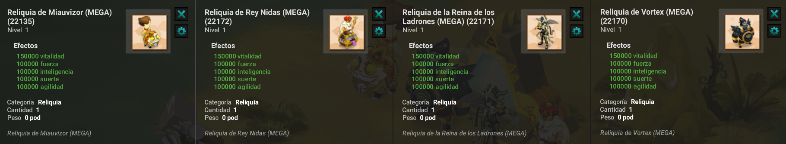

# 🎲 Artemis'Farm Universal — Guía Completa de Artemis

La **Reliquia Artemis'Farm Universal** (o *Reliquia de Farm'Univers*) es una de las reliquias más poderosas de Artemis. Evoluciona a medida que derrotas a los **jefes dimensionales** y superas sus distintas variantes de dificultad: **Normal**, **Mega**, **Giga** y **Tera**.

Esta guía detalla el sistema de progresión, las estadísticas que otorga cada jefe, las condiciones de acceso y las mecánicas clave para retirar la invulnerabilidad de los bosses.

---

## ⚙️ 1. Características y Estadísticas de la Reliquia

Cada uno de los cuatro jefes dimensionales aporta un atributo elemental específico a la reliquia, mientras que todos ellos contribuyen al incremento de la vitalidad:

* **Inteligencia 🔥:** Se adquiere a través del **Vórtex**.
* **Agilidad 🍃:** Se adquiere a través de la **Reina de los Ladrones**.
* **Fuerza 🌲:** Se adquiere a través del **Miauvizor**.
* **Suerte 💧:** Se adquiere a través de **Nidas**.
* **Vitalidad ❤️:** Es aumentada de manera conjunta por los cuatro jefes anteriores.

---

## 🏰 2. Tipos y Dificultades de Mazmorras

Para cada jefe dimensional existen 4 categorías de mazmorras que permiten subir de nivel tu reliquia:

1. **Mazmorras Normales:** Enfrentamiento base contra el jefe dimensional de nivel 200.
2. **Mega Mazmorras:** Versión de mayor dificultad que introduce mecánicas especiales de invulnerabilidad y requisitos de acceso.
3. **Giga Mazmorras:** Combates extendidos que requieren desbloquear la invulnerabilidad múltiples veces.
4. **Tera Mazmorras:** El reto supremo, reservado para personajes optimizados con la reliquia previamente maximizada.

---

## 📈 3. Progresión de la Reliquia

### Ejemplo práctico: Aumentar Inteligencia con el Vórtex
1. **Paso 1 (Normal):** Completa el Vórtex Normal para iniciar la acumulación de Inteligencia hasta su límite inicial.
2. **Paso 2 (Mega):** Supera la Mega Mazmorra una vez alcances las estadísticas mínimas requeridas y domines su mecánica de desbloqueo.
3. **Paso 3 (Giga):** Avanza a la Giga Mazmorra para superar el siguiente tope de estadísticas.
4. **Paso 4 (Tera):** Enfrenta la Tera Mazmorra cuando la reliquia haya alcanzado el tope de la etapa Giga.

> 💡 **Nota:** Este mismo recorrido debe replicarse con los otros 3 jefes (Reina de los Ladrones, Miauvizor y Nidas) para maximizar equitativamente la Agilidad, Fuerza, Suerte y Vitalidad.

### Límites de Estadísticas por Nivel de Mazmorra

| Dificultad | Estadísticas Máximas | Máxima Vitalidad |
| :--- | :--- | :--- |
| **Normal** | Hasta **50.000** Stats | Hasta **200.000** Vitalidad |
| **Mega** | Hasta **250.000** Stats | Hasta **500.000** Vitalidad |
| **Giga** | Hasta **500.000** Stats | Hasta **1.000.000** Vitalidad (1M) |
| **Tera** | Hasta **1.000.000** Stats (1M) | Hasta **2.000.000** Vitalidad (2M) |

---

## ⁉️ 4. Progreso del Combate y Mecánicas de Invulnerabilidad

Las batallas contra los jefes dimensionales se disputan a lo largo de **5 oleadas**.

En las dificultades **Mega** y **Giga**, los jefes cuentan con un estado de **Invulnerabilidad** que debe ser retirado cumpliendo una acción específica:

* **Megajefes:** Requieren desbloquear la invulnerabilidad **1 vez**.
* **Gigajefes:** Requieren desbloquear la invulnerabilidad **3 veces**.

### Acciones para retirar la invulnerabilidad según el Jefe:

| Jefe | Icono | Acción Requerida para Desbloquear |
| :--- | :---: | :--- |
| **El Miauvizor** | 👁️ | Empujarlo al menos **1 casilla**. |
| **El Vórtex** | 🔥 | **Curarlo**. |
| **La Reina de los Ladrones** | 🌀 | Provocarle **retiro de PM** *(el debuff solo cuenta si el retiro es exitoso, no esquivado)*. |
| **Nidas** | 💰 | Provocarle **retiro de PA** *(el debuff solo cuenta si el retiro es exitoso, no esquivado)*. |

---

## 🔱 5. Reliquias de Megamazmorras

* Al superar las mazmorras dimensionales, no solo progresa la Reliquia Artemis'Farm Universal, sino también las **Reliquias de Megamazmorras**.
* Existen **4 reliquias de Megamazmorras** que se van mejorando y se maximizan tras completar un número determinado de veces cada Megamazmorra respectiva.

---

## ⚠️ 6. Regla de Mejora de la Reliquia

> **Requisito indispensable:**  
> Para poder subir las estadísticas de la reliquia en una mazmorra de nivel superior (Mega, Giga o Tera), **debes haber alcanzado primero el tope máximo de estadísticas de la dificultad anterior**.  
> De lo contrario, no obtendrás progreso de estadísticas para tu reliquia al derrotar al jefe.

---

## 🚫 7. Requisitos de Acceso a las Mazmorras

Para acceder a las salas de cada mazmorra dimensional avanzada, tu personaje debe cumplir con los siguientes requisitos:

| Mazmorra | Nivel Requerido | Estadísticas Mínimas Totales del Personaje |
| :--- | :---: | :---: |
| **Mega Dungeon** | — | **12.000.000** de estadísticas en total |
| **Giga Dungeon** | **Nivel Máximo (LP5 P10 1400)** | **34.000.000** de estadísticas en total |
| **Tera Dungeon** | **Nivel Máximo (LP5 P10 1400)** | **56.000.000** de estadísticas en total |

---

## 🎯 Conclusión y Ruta de Progresión

La Reliquia Artemis'Farm Universal constituye uno de los mayores proyectos de optimización del personaje:

1. **Normal:** Inicio de progresión y base de la reliquia.
2. **Mega:** Fortalecimiento del personaje y desbloqueo de las reliquias secundarias.
3. **Giga:** Escalado a niveles de endgame.
4. **Tera:** Desbloqueo del poder legendario máximo del universo.
