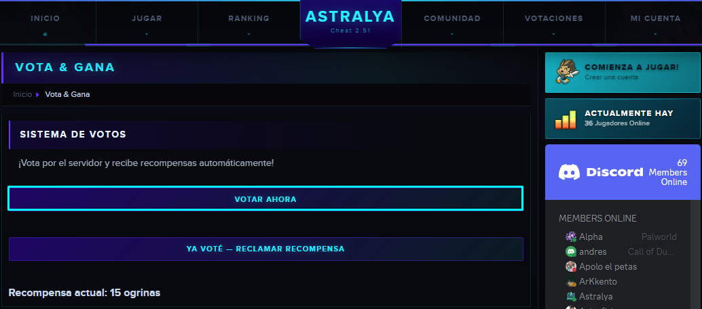
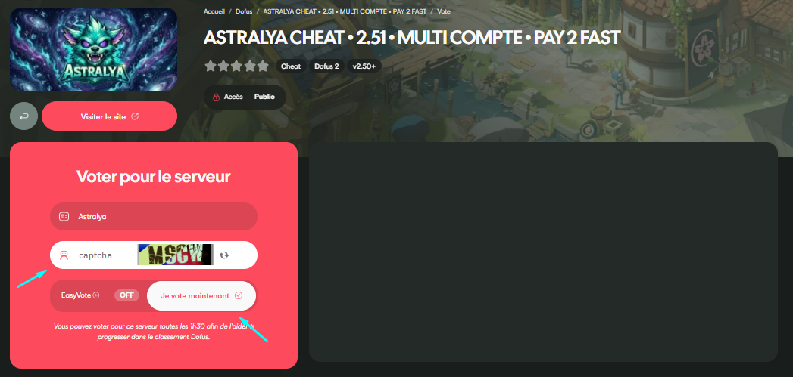
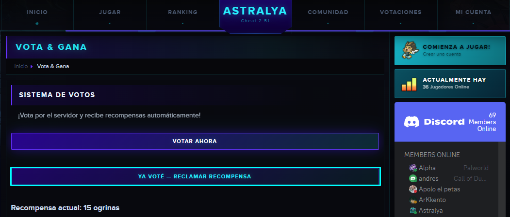
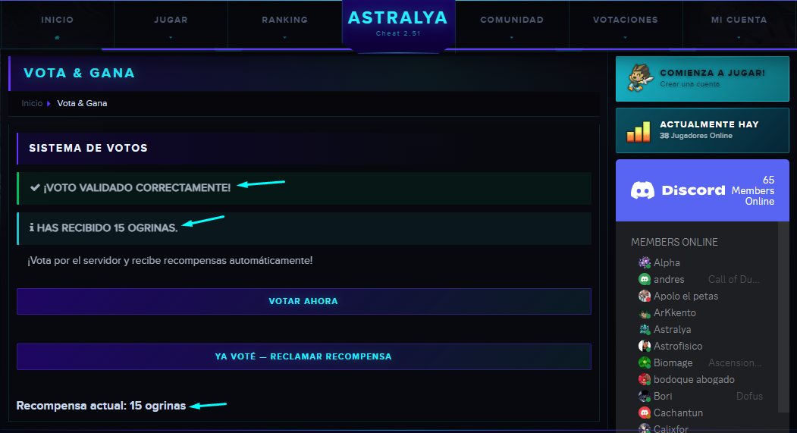
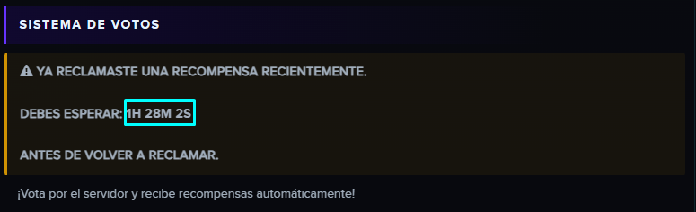

# Vota y gana

### ❓ ¿Por qué votar?

* ✅ Cada voto te otorga 15 **ogrinas**.
* 🍀**Reliquia del Mes** al completar 100 Votos o más.
* 📈 Los votos ayudan a que **Artemis** se mantenga en los primeros puestos del ranking de servidores → más visibilidad, más jugadores, más aventuras para todos.

### 🖱️ ¿Cómo votar?

1. **Acceda a la sección de votación.**
   \
   Inicie sesión en el sitio web oficial de Artemis y vaya a la pestaña de [**Votación**](https://artemis.mservers.ovh/vote)&#x20;

<figure><figcaption></figcaption></figure>

2. **Vota en** **serveur-prive.net.**
   \
   Haz clic en el enlace proporcionado y sigue las instrucciones.

<figure><figcaption></figcaption></figure>

3. **Verificación de IP**\
   ⚠️ Utilice **la misma dirección IP** en serveur-prive.net y en nuestro sitio → esto es esencial para validar su voto.
4. **Valida tu voto en Artemis.**\
   Una vez que hayas votado, haz clic en **YA VOTÉ - RECLAMAR RECOMPENSA** en nuestro sitio para recibir automáticamente tus Ogrinas.

<figure><figcaption></figcaption></figure>

<figure><figcaption></figcaption></figure>

5. **Seguimiento de votos**

* ⏳ En el sitio web se muestra un temporizador que indica el tiempo restante antes de su próximo voto.
* Esto te permite votar regularmente sin olvidarte ni perder la fecha límite.

<figure><figcaption></figcaption></figure>

### ⚠️ ¿Por qué es importante seguir las instrucciones cuidadosamente?

Si no se siguen las instrucciones (especialmente la dirección IP idéntica), **es posible que su voto no se contabilice** . El resultado: menos votos contabilizados, menor impacto para Artemis y menos recompensas para usted.

### 💙 ¡Gracias por tu apoyo!

Al votar regularmente, usted contribuye a:

* 🌟 Astra en crecimiento.
* 🎁 Gana ogrinas y Reliquias exclusivas.
* 🤝 Apoya a nuestra comunidad.

<mark style="color:cyan;">Michael :)<mark style="color:cyan;">

---