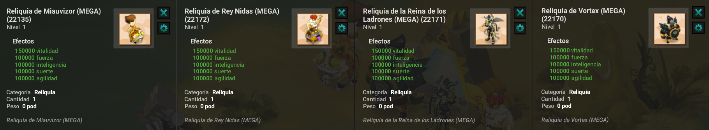

# Astral'Farm Universal

La **Reliquia Astral'Farm** es una de las reliquias más poderosas de Artemis. Evoluciona al derrotar **a los jefes dimensionales** y sus variantes (Normal, Mega, Giga, Tera). Esta guía explica cómo progresar, los requisitos de acceso a las diferentes mazmorras y las mecánicas especiales que debes dominar.

---

### ⚙️ 1. Características de la reliquia

Las estadísticas de la Reliquia Astral'Farm Universal provienen de los **jefes dimensionales** :

* **Inteligencia 🔥**: Se adquiere a través del Vórtex.
* **Agilidad 🍃**: Se adquiere a través de la Reina de los Ladrones.
* **Fuerza 🌲**: Se adquiere a través del Miauvizor.
* **Suerte 💧**: Se adquiere a través de Nidas.
* **Vitalidad ❤️**: Aumentada por los cuatro jefes anteriores.

---

### 🏰 2. Tipos de mazmorras

Para cada jefe mencionado, hay cuatro tipos de mazmorras para progresar con tu reliquia:

* **Mazmorras normales**: Jefe dimensional de nivel 200.
* **Mega Mazmorras**: Una versión más desafiante con mecánicas especiales.
* **Giga Mazmorras**: Batallas extendidas y múltiples desbloqueos.
* **Tera Mazmorras**: El desafío definitivo, que requiere que ya hayas maximizado la reliquia.

---

### 📈 3. Progresión de reliquias

#### Ejemplo práctico: mejorar Inteligencia con el Vórtex

1. Completa el Vórtex normal para iniciar la progresión de Inteligencia.
2. Supera la Mega Mazmorra cuando tengas acceso a sus mecánicas especiales.
3. Continúa con la Giga Mazmorra para conseguir los desbloqueos necesarios.
4. Enfrenta la Tera Mazmorra cuando la reliquia esté maximizada.

Repite el mismo recorrido con cada jefe dimensional. Así aumentarás Agilidad, Fuerza, Suerte y Vitalidad.

| Tipo de mazmorra | Estadísticas máximas | Máxima vitalidad |
| :--- | :--- | :--- |
| **Normal** | Hasta 50.000 de Estadísticas | Hasta 200.000 de Vitalidad |
| **Mega** | Hasta 250.000 de Estadísticas | Hasta 500.000 de Vitalidad |
| **Giga** | Hasta 500.000 de Estadísticas | Hasta 1 Millón de vitalidad |
| **Tera** | Hasta 1 Millón de Estadísticas | Hasta 2 Millones de Vitalidad |

---

### ⁉️ 4. Explicación Del progreso Del Combate y Desventajas

Las batallas contra los jefes dimensionales se desarrollan a lo largo de **5 oleadas**. En las oleadas **Mega** y **Giga**, los jefes tienen una **invulnerabilidad** que debe eliminarse siguiendo una mecánica específica:

* Los **Megajefes** y **Gigajefes** tienen invulnerabilidad, ¡así que tendrás que quitársela! Ten en cuenta que para los Megajefes tendrás que desbloquearla **una vez**, pero para los Gigajefes tendrás que desbloquearla **tres veces**.
* **El Miauvizor 👁️:** Tendrás que empujarlo al menos una casilla.
* **El Vórtex 🔥:** Será necesario curarlo.
* **La Reina de los Ladrones 🌀:** Tendrás que provocar su eliminación de PM *(Si la eliminación no se lleva a cabo, el debuff no cuenta)*.
* **Nidas 💰:** Tendrás que provocarle el retiro de PA *(Si no se realiza el retiro, el debuff no cuenta)*.

---

### 🔱 5. Mejora De Reliquias y Explicación

* La Reliquia de Farm'Univers se mejora al derrotar a los jefes en las mazmorras dimensionales correspondientes.
* Cada tipo de mazmorra permite aumentar las estadísticas y la vitalidad de la reliquia hasta un límite determinado, como se describió anteriormente.
* Reliquias de Megamazmorras que mejoran al completarlas. Hay cuatro y se maximizarán al completar un número determinado de mazmorras de la Megamazmorra en cuestión.

<figure><figcaption></figcaption></figure>

---

### ⚠️ 6. Condiciones Para La Mejora de Astral'Farm

Para mejorar tus estadísticas en esta reliquia, debes alcanzar el máximo de estadísticas anteriores. Sin estas condiciones, no podrás progresar con tu reliquia en estas mazmorras.

---

### 🚫 7. Condiciones De Acceso a Mazmorras

* **Acceso al Mega Dungeon:** Tener un mínimo de **12.000.000** de estadísticas en total para acceder a esta área.
* **Acceso al Giga Dungeon:** Estar en el nivel máximo (**LP5 P10 1400**) y tener un mínimo de **34.000.000** de estadísticas en total.
* **Acceso a la mazmorra Tera:** Estar en el nivel máximo (**LP5 P10 1400**) y tener un mínimo de **56.000.000** de estadísticas en total.

---

### 🎯 Conclusión

La Reliquia de Farm'Univers representa un **largo camino de progresión**, que requiere paciencia y estrategia.

* ✅ **Normal** para principiantes.
* ✅ **Mega** para fortalecer.
* ✅ **Giga** para alcanzar un alto nivel.
* ✅ Finalmente **Tera** para revelar **todo su poder legendario.**

¡Buena suerte, aventurero, en tu búsqueda para forjar la **reliquia definitiva del universo**! 🏆
