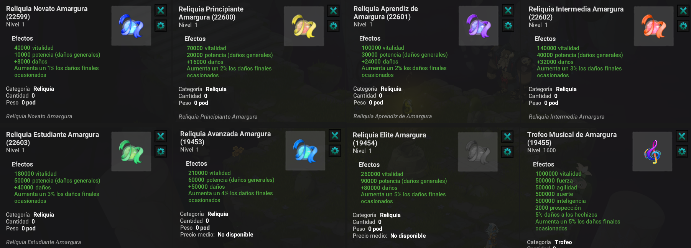

# Mazmorra Amargura

Esta mazmorra va aumentando sus estadísticas progresivamente, se debe realizar con paciencia y no dedicarse exclusivamente a ella para evitar la monotonía.

### 🌠 Principio de la Mazmorra Amargura

* La mazmorra cuenta con 3 Salas contra varios monstruos.
* Objetivo principal: Consigue fichas de amargura al completar la última sala.

### 🎁 Sistema de Recompensas

* La cantidad de fichas obtenidas se basa en el piso actual del jugador.
* Ejemplo: Si estás en el piso 10 y ganas la pelea para pasar al piso 11 , obtienes 11 fichas.

Recompensas adicionales cada 10 piso&#x73;**,** en cada nivel de 10 pisos , recibirás:

* Las fichas del piso correspondiente .
* Un bono multiplicador x3 .

**Ejemplo para el piso 20**:

* 20 tokens + 20 x 3 tokens = 80 tokens en total.

<mark style="color:red;">Nota: No es posible regresar a pisos anteriores.<mark style="color:red;">

### 🎰 Tienda Amargura&#x20;

Accesible al final de la mazmorra para gastar tus Fichas de Amargura.

* Varias reliquias que proporcionan daño final para mejorar tu personaje.
* Un poderoso Trofeo , consíguelo para aumentar tu fuerza y ​​tus habilidades.

<figure><figcaption></figcaption></figure>

### ⚠️ Condiciones de Uso

Deben tener en cuenta, que para que estas reliquias les cuenten los stats deben estar en el Nivel o Piso estipulado en la parte superior de este mensaje con el trofeo igual si no están en Piso 300 no se los dejará equipar.

* **Reliquia Novato:** Adquirible en piso 20.
* **Reliquia Principiante:** Adquirible en piso 60.
* **Reliquia Aprendiz:** Adquirible en piso 100.
* **Reliquia Intermedia:** Adquirible en piso 140.
* **Reliquia Estudiante:** Adquirible en piso 180.
* **Reliquia Avanzada:** Adquirible en piso 220.
* **Reliquia Élite:** Adquirible en piso 260.
* **Trofeo Musical Amargura:** Adquirible en piso 300.

### 🎯 Conclusión

* ✅ Progresión basada en niveles con recompensas crecientes.
* ✅ Bonificaciones significativas cada 10 pisos, que incentivan el progreso constante.
* ✅ Tienda que ofrece artículos únicos y poderosos para personalizar y fortalecer tu personaje.
* ✅ Total de pisos es de 300.

---