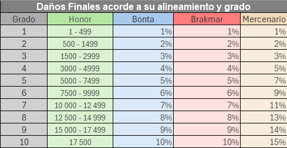
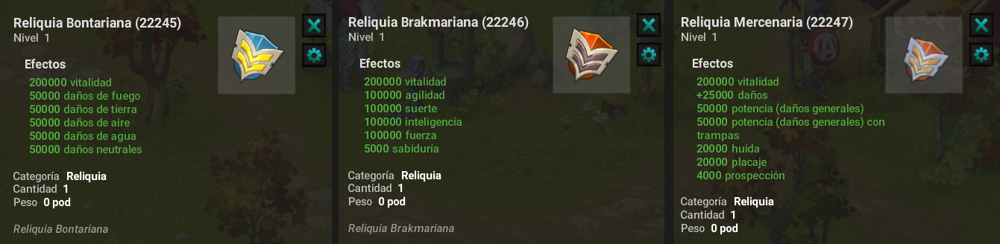

# Mazmorra PVP

Es sencillo desde el custom panel **Teletransportador** allí en Dj Personalizado podrás encontrar la mazmorra, debes contar con un alineamiento activo, ya sea bonta o brakmar para iniciar para esto deberás ir a .pvp allí adquieres un alineamiento.

### ☠️ Mazmorra&#x20;

El sistema PVP En Artemis está integrado en mazmorras especiales donde luchas contra monstruos mientras te enfrentas a desafíos jugador contra jugador. Para participar, debes elegir una de las tres alineaciones disponibles: Bonta, Brakmar o Mercenario.

<mark style="color:red;">**Importante:**<mark style="color:red;"> <mark style="color:red;"> <mark style="color:red;">Puedes seleccionar o cambiar la alineación en el mapa PVP ubicado en Amakna Village , en \[-1,0] , podrás ir usando el comando .pvp &<mark style="color:red;"> <mark style="color:red;">para convertirte en Mercenario, debes adquirir el Pase de Mercenario.<mark style="color:red;">

### 💎 Reliquias y Sistema de Rangos

En estas mazmorras se pueden mejorar tres reliquias únicas, una por cada alineamiento. Cada vez que completes una mazmorra, mejorarás:

* Tu reliquia.
* Tu rango de alineación.

### ❔ **¿Cómo funcionan las calificaciones?**

Cuanto más alto sea tu rango, más poderosa será tu reliquia.

<mark style="color:red;">**Consejo:**<mark style="color:red;"> <mark style="color:red;"> <mark style="color:red;">Aprovecha el refuerzo del jueves para acumular más puntos de honor y alcanzar el siguiente rango más rápido.<mark style="color:red;">

### 💥 Daños Finales de Acuerdo al Alineamiento y Grado

El poseer alas te trae como beneficio daños finales, sin embargo para que estos sean notables deberás tener activas tus alas.

<figure><figcaption></figcaption></figure>

### 🪐 Limites y Honor

* Al iniciar una batalla, se te desequiparán algunos items, es importante estar un tanto avanzado y llevar una raza que te beneficie en cuanto a tiempo.
* Al ganar una batalla podrás obtener 20 de honor, por el contrario si pierdes serán -150 de honor.
* Despues del grado 5 obtendrás **Chaveuvepe** y a medida que avances de grado ganarás más, con estas fichas podrás canjearlas en la tienda de .pvp

<figure><figcaption></figcaption></figure>

### 🎯 **Conclusión**

El sistema PVP en **Artemis** es esencial para la progresión de tu personaje y el aumento de su poder.

👉 No descuides estos aspectos, ya que son fundamentales para optimizar tu experiencia de juego en el servidor.

---