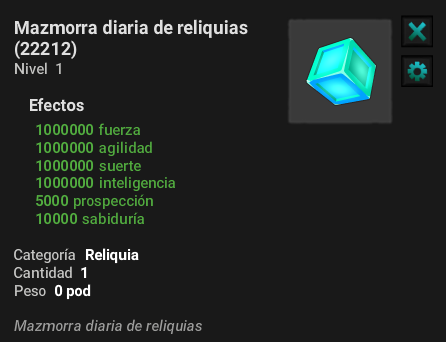

# Mazmorras Diarias

### 🏰 Mazmorras diarias en Merkasako

**Las mazmorras diarias** son una actividad diaria a la que puedes acceder directamente desde tu **Bolsa de Merkasako** (clave `H`). Te permiten progresar con regularidad y obtener **recompensas únicas** cada día.

### ⚙️ Características principales

* 🔑 **Acceso diario** : hasta **2 entradas por día** para cada mazmorra.
* 🎟️ **Pase diario para mazmorras** *(Boutique)* : aumenta el límite a **4 entradas por día** .
* 📈 **Dificultad creciente** : cuanto más alto subas de piso, más difíciles serán los desafíos… ¡pero también las recompensas!
* 🎁 **Recompensas únicas** : cada mazmorra tiene sus propios bonos y objetos exclusivos.

<mark style="color:blue;">💡 Consejo: Utiliza el<mark style="color:blue;"> <mark style="color:blue;"> <mark style="color:blue;">**Pase Diario de Mazmorras**<mark style="color:blue;"> <mark style="color:blue;"> <mark style="color:blue;">si buscas un progreso rápido o recursos específicos.<mark style="color:blue;">

### 📜 Lista de mazmorras

#### ⚡ 1. Mazmorra de Pase de Batalla

* 🎯 Objetivo: **adquirir Insignias rápidamente**.

#### 💎 2. Mazmorra de Astral'Ton

* 🎯 Objetivo: **obtener fichas de Astral'ton.**

#### 🌀 3. Mazmorra de Ogrinas

* 🎯 Objetivo: **recolectar ogrinas**.

#### 🎉 4. Evento de mazmorra

* 🎯 Objetivo: **participar en eventos especiales** .
* 🔄 El contenido cambia según los acontecimientos actuales.
* 🎟️ Recompensas: **Fichas del evento** para canjear Zona Eventos.

#### 🛡️ 5. Mazmorra de las reliquias

* 🎯 Objetivo: **Mejora tu Reliquia de Mazmorra Diaria**.

<figure><figcaption></figcaption></figure>

### 🔰 **Detalles Adicionales**

* **Dificultad creciente :** Cuanto más alto sea el nivel en cada mazmorra, más difícil se vuelve. A cambio, las recompensas también se vuelven más atractivas.
* **Recompensas únicas :** Cada mazmorra ofrece recompensas específicas según su tipo y el nivel alcanzado.

✨ ¡Buena suerte, aventurero, y que tus pisos sean muchos!

---