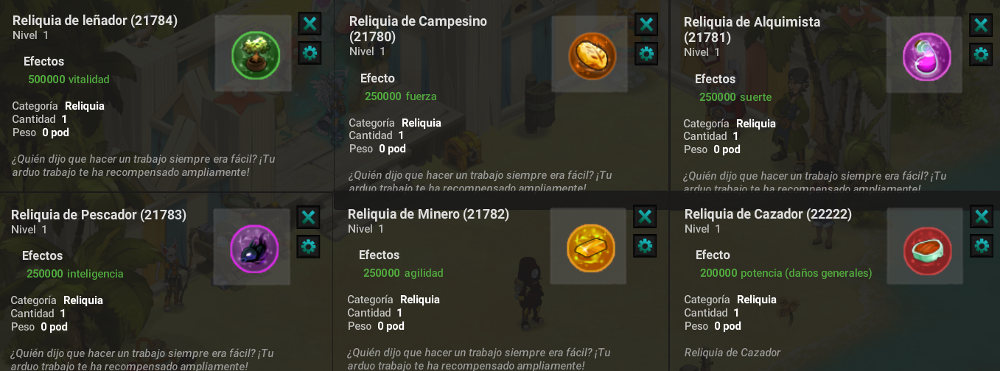
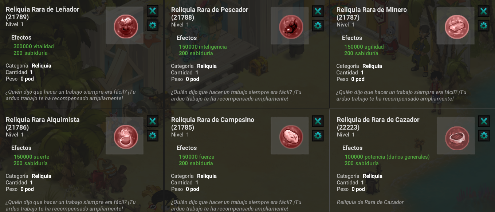
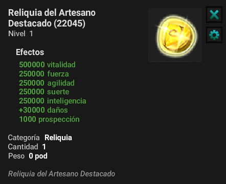
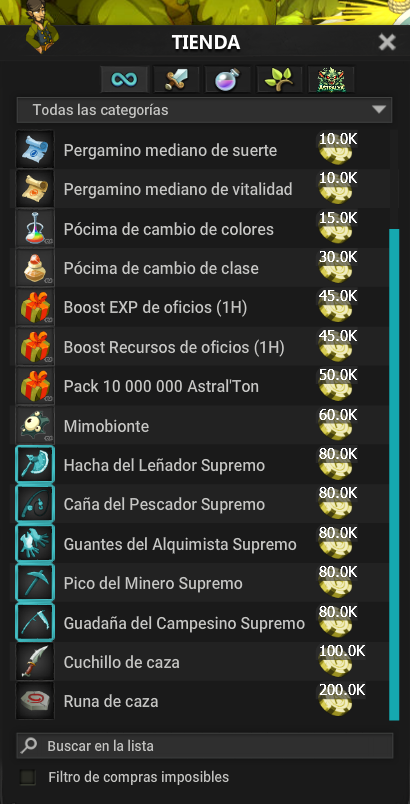
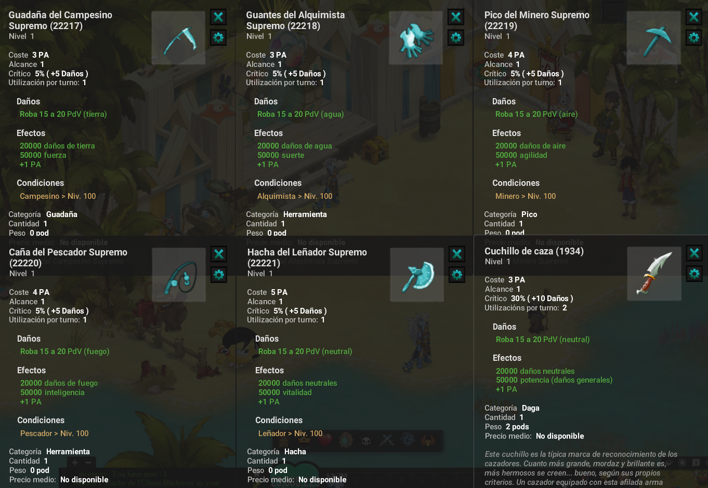

# Oficios Artemis

### 🛠️ 1. Guía profesional en Artemis

¡Bienvenido, aventurero! Las **profesiones en Artemis** difieren de las de los MMO tradicionales:

* ❌ No se permite la artesanía clásica.
* ✅ Progresión **manual** y **agricultura intensiva** .
* 🎁 Recompensas exclusivas en forma de **reliquias** , **armas de profesión** y **bonificaciones únicas**.

### 🌟 2. Reliquias

#### 📌 Reliquias comunes

* Progresan automáticamente al **reunir recursos para la** profesión correspondiente.
* Cada acción de recolección aumenta directamente el poder de la reliquia.
* No se necesitan recursos de prestigio para mejorarlo.

<figure><figcaption></figcaption></figure>

#### 🔝 Prestigio en Oficio

Por ahora los prestigios estan disponibles para todos los oficios menos cazador.

* **Prestigio 1:** 1.000.000 Vitalidad, 500.000 Elementos.
* **Prestigio 2:** 1.500.000 Vitalidad, 750.000 Elementos.
* **Prestigio 3:** 2.000.000 Vitalidad, 1.000.000 Elementos.

<mark style="color:red;">Nota: Debes ser nivel 200 para realizar tu prestigio de oficio.<mark style="color:red;">

#### 🔮 Reliquias Raras

Se obtiene al reunir recursos de fabricación.

* Leñador 🌲: 300.000 Vitalidad y 200 Sabiduría.
* Alquimista 🌿: 150.000 suerte y 200 sabiduría.
* Minero ⛏️: 150.000 Agilidad y 200 Sabiduría.
* Pescador 🎣: 150.000 de Inteligencia y 200 de Sabiduría.
* Campesino 🌾: 150.000 de Fuerza y ​​200 de Sabiduría.
* Cazador 🥩: 100.000 de Potencia y 200 de Sabiduría.

Estas reliquias requieren recursos recolectados por el jugador como parte de su profesión.

<figure><figcaption></figcaption></figure>

#### ✨ **Reliquia Del Artesano**

Además de las reliquias raras, es posible crear la Reliquia del Artesano Destacable. Esta reliquia requiere los recursos de todas las profesiones.

* Fusión de recursos de **todas las profesiones**.
* Funciona como una reliquia rara mejorada.

<figure><figcaption></figcaption></figure>

### 🍖 3. **Explicación** **Oficio Cazador**

Para empezar a subir este oficio deberán contar con algunos requisitos:

* Tener Todos los Oficios al Nivel Máximo es decir 200.
* Deberán Tener las 5 Reliquias de Oficio Raras.
* Maguear el arma con la **Runa de Caza**, esta la podrán encontrar en la Tienda de Artemis'Jobs (Funciona en cualquier arma).

**IMPORTANTE:** En la misma tienda de Jobs podrán encontrar el **Cuchillo de Caza** este les da como beneficio obtener x2 en XP & Recursos del oficio cazador.

<figure><figcaption></figcaption></figure>

## 🔝 4. ¿Como Y Donde Levear Oficio Cazador?

Te dejo un excel donde te explica a la perfección donde adquirir los recursos para subir y la cantidad de xp brindada.

👉 [Excel Guia Cazador](https://www.mediafire.com/file/b2ujzhowp39en8e/OFICIO+CAZADOR.xlsx/file)

<mark style="color:red;">Recomendacion: Aprovechar los dias de bonus, los boost de tienda job, y recordar que entre mayor sea el recurso que tales, seges, mines o pesques más stats te dará a la reliquia y más xp.<mark style="color:red;">

### ⚒️ 5. Armas de Oficios

Las armas específicas de cada profesión se pueden obtener al obtenerlas. Cada profesión tiene su propia arma, con una tasa de obtención fija. Esta tasa depende del nivel del recurso que se esté recolectando (obtenido del protector de recursos), y varía entre el 0,1 % para un recurso de nivel 1 y el 2 % para un recurso de nivel 200.\
\
Llevar alguna de estas armas cuando se esta realizando el oficio trae algunos beneficios consigo

* Cosecha de recursos x2.
* Drop de Artemis'Job x2.
* 20% más de bonus de subida en stats en la reliquia.

<figure><figcaption></figcaption></figure>

### 🎯 Conclusión

Los trabajos en Artemis son un **pilar fundamental del progreso** :

* 🚀 **Reliquia común** : se potencia automáticamente con tus cosechas.
* ⚡ **Reliquia rara** : mejorada mediante **recursos de prestigio**.
* 🎁 Reliquias adicionales, armas inigualables y elaboradas para artesanos expertos.

👉 ¡Sube de nivel tus profesiones para alcanzar nuevas cotas de poder y optimizar tu aventura en Artemis!

---