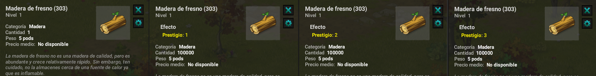
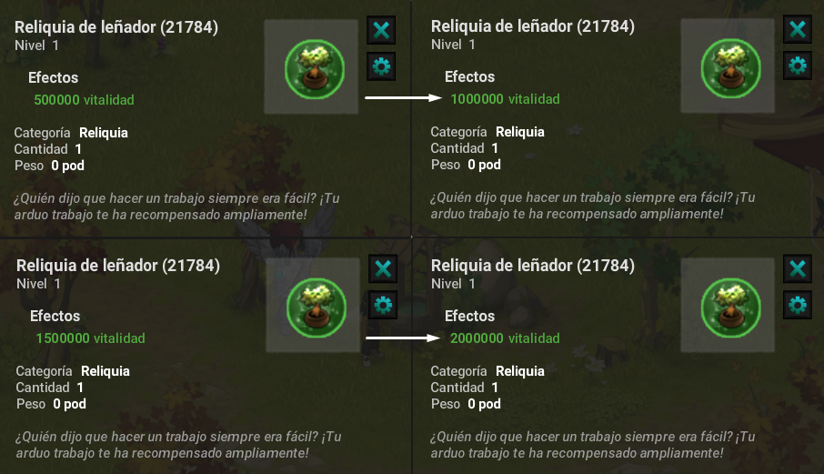
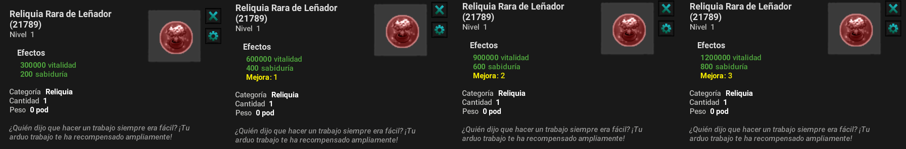

# Prestigio Oficios

Ahora también podrás prestigear tus oficios si los tienes al máximo de esta manera aumentarás tus estadísticas de manera significativa beneficiándote de mayor daño.

### ❓ **¿Como Prestigear Mis Oficios?**

Prestigear un oficio es más sencillo de lo que puedes pensar:

* Deberás contar con tu oficio a nivel 200.
* Contar con La Pócima de Ambrosía.
* Maximo de Prestigios de oficio es 3.

<figure><figcaption></figcaption></figure>

<mark style="color:red;">Nota: Podrás adquirir estas pócimas en boutique o por receta con el comerciante de recursos de oficios de<mark style="color:red;"> <mark style="color:red;"> <mark style="color:red;">**Zona NPC.**<mark style="color:red;">

### 🛠️ Recursos de Oficio

A medida que logres alcanzar tu siguiente prestigio el recurso será diferente, cada recurso farm ahora sera del prestigio en el que te encuentres, y estos podrán ser utilizados para mejorar las reliquias raras el cual se explicará más adelante.

<figure><figcaption></figcaption></figure>

### 🏹 Aumento de Reliquias de Oficio

No solo te beneficias de nuevos recursos dependiendo de tu prestigio, tus reliquias también podrán seguir aumentando sus estadísticas duplicando sus stats, por ejemplo:

* **Prestigio 1:** 1.000.000 Vitalidad, 500.000 Elementos.
* **Prestigio 2:** 1.500.000 Vitalidad, 750.000 Elementos.
* **Prestigio 3:** 2.000.000 Vitalidad, 1.000.000 Elementos.

<figure><figcaption></figcaption></figure>

### 🔆 Aumento Reliquias Raras de Oficio

En Zona NPC podrás encontrar un nuevo npc llamado **Mejora Reliquias** **de Profesión** con este npc podrás realizar la mejora de cada reliquia rara.

* Deberás entregar los mismos recursos.&#x20;
* La misma cantidad pedida a la que realizas para obtener por primera vez la reliquia rara.

<figure><figcaption></figcaption></figure>

<mark style="color:red;">Nota: Los recursos deberán ser del prestigio de oficio a mejorar.<mark style="color:red;">

### 🎯 **Conclusión**

Ahora con el aumento de prestigios las estadísticas de la **Reliquia de Oficio** y las **Reliquias Raras** mejoran y ayudan en el proceso de este servidor facilitando algunos momentos o circunstancias.

---