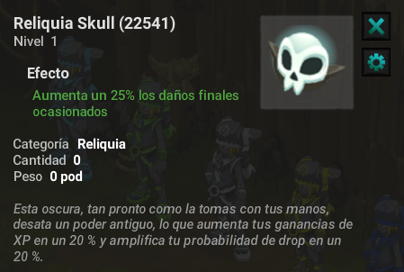
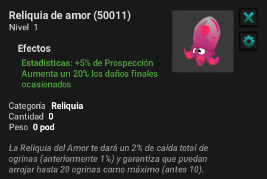
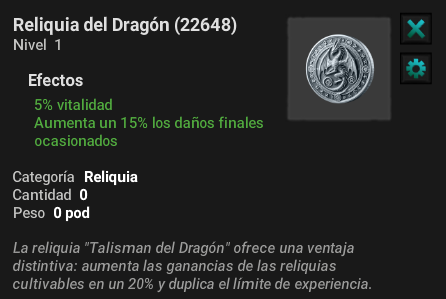
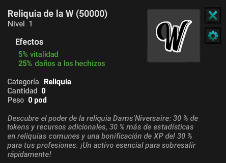

# Reliquias con Bonus

En Artemis algunas de nuestras reliquias mas preciadas tienen un bonus especial ademas de las estadísticas que ya brinda de por si una reliquia pasiva normal, estas reliquias están diseñadas para que puedas avanzar y ser uno de los mas fuertes de nuestro servidor.

¿En que consisten o cuales son? Aquí te lo explicamos: Estas reliquias te dan estadísticas pasivas es decir que no requieren estar equipadas para sumar sus stats, bastara con tenerlas en tu inventario, el **Bonus** que da cada reliquia variara pero te ayudarán en oficios, ogrinas, xp y mucho más...

### :skull: Reliquia Skull

#### :fire: ¿Qué hace SKULL?

* +20% XP FINAL en cada combate.
* +20% probabilidad de DROP REAL (no multiplicador, es directo :fire:).
* Funciona solo con tenerla en el inventario.

#### :moneybag: ¿Por Qué Es Tan Buena?

Porque no depende de suerte momentánea…

* Aumenta tus drops de forma constante.
* Acelera tu progreso en TODOS los combates.
* Es especialmente poderosa en drops raros.

#### :zap: Perfecta Para:

* Farmear recursos valiosos.
* Subir nivel más rápido.
* Optimizar tiempo al máximo.

<figure><figcaption></figcaption></figure>

### 💞 Reliquia de Amor&#x20;

#### :fire: **¿Qué hace la reliquia de amor?**

Algunas batallas (lvl 200+) tienen probabilidad de darte **Ogrinas (1 a 10)** Con esta reliquia:

* x2 probabilidad de drop.
* x2 cantidad de Ogrinas obtenidas.

#### :moneybag: **Resultado:**

Más combates = más oportunidades = **muchas más Ogrinas**

:sparkling\_heart: No cambia tu suerte… la multiplica.

<figure><figcaption></figcaption></figure>

### :dragon: Reliquia del Dragón

#### :fire: **¿Qué hace la reliquia del dragón?**

* +50% al límite máximo de XP por combate.
* +20% a las mejoras de todas tus reliquias.

#### :zap: **¿Por qué es tan poderosa?**

* Si estás farmeando XP → ganas MUCHO más.
* Tus reliquias crecen más rápido y más fuertes.

#### :gem: **Resultado:**

Más progreso, mejores stats y ventaja acumulativa con el tiempo

:dragon: No te hace fuerte al instante… te hace imparable.

<figure><figcaption></figcaption></figure>

### :trophy: Reliquia De La W &#x20;

#### :fire: **¿Qué hace la reliquia de la w?**

* +30% recursos obtenidos al recolectar oficios.
* +30% de Astral'Job.
* +30% XP de oficios.
* +30% progreso de reliquias de oficio.

#### :zap: **¿Por qué es clave?**

* Farmeas más en menos tiempo.
* Subes oficios mucho más rápido.
* Tus reliquias de oficio crecen **más fuerte y más rápido**

#### :gem: **Resultado:**

Más recursos, más XP y progreso acelerado en todo el sistema de oficios

:trophy: **No es suerte… es eficiencia pura.**

<figure><figcaption></figcaption></figure>

### 🎯 **Conclusión**

Todas estas reliquias podrás encontrarlas en nuestro custom panel **Boutique** Apartado de reliquias, allí están disponibles y son exclusivas por ogrinas, Conviértete en ese jugador que siempre va un paso adelante.

---