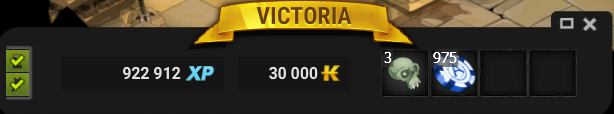
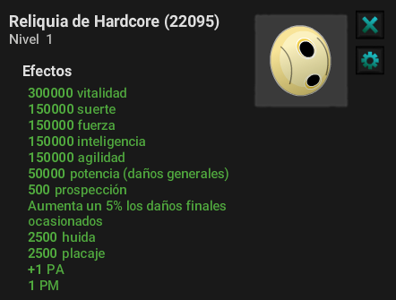
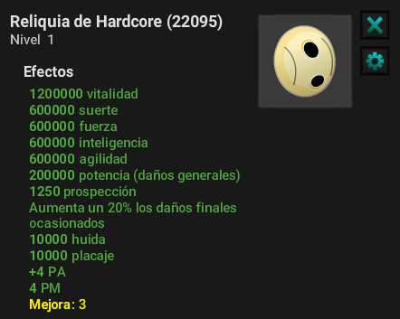
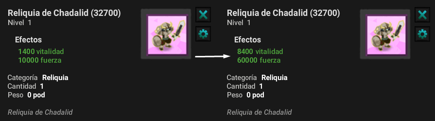
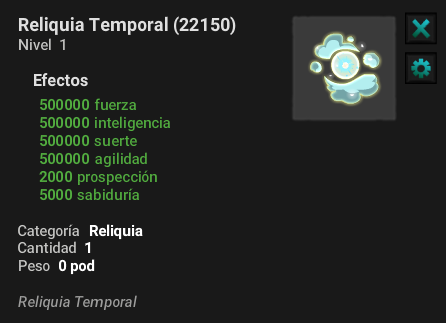

# Reliquias de Mazmorra

Esta guía detalla las reliquias disponibles en el juego, sus estadísticas y los métodos para mejorarlas en los diferentes modos de juego:

* Hardcore
* Temporal
* Artemis'Hard

Cada modo ofrece pasos específicos para maximizar el poder de las reliquias y permitir una progresión óptima.

### 🕹️ Modos de Juego y Mejora

Las reliquias se obtienen primero en el modo Hardcore . Una vez adquiridas, se pueden mejorar en los siguientes modos:

* **Modo Temporal:** Las reliquias obtienen un multiplicador x5 en las estadísticas generales, x2 en Potencia Prospección y en Daño.
* **Modo Artemis'Hard:** las reliquias alcanzan su máximo potencial con un multiplicador x2 en las estadísticas Temporales.

### 🎳 ¿Como Adquirir y Entrar en Alguno de los Modos?

Podrás encontrar la zona Temporal y Artemis'Hard en el Custom Panel, apartado *Esencial*

* **Para entrar en Modo Temporal:** Necesitarás tener todas las Reliquias Hardcore, y un mínimo de 8.400.000 de estadísticas.
* **Para el Modo Artemis'Hard:** Aún esta siendo trabajada por lo cual no podrás ingresar momentaneamente, esperamos tener pronto disponible esta zona.

### 👹 Modo Hardcore

Ahora que el Modo Hardcore está habilitado, puedes comenzar a cultivar tus Reliquias de Mazmorra: en la sala del jefe obtendrás los recursos del jefe en cuestión.

<mark style="color:red;">Nota: Si eres pj Normal obtienes x1, Si tienes Vip obtienes x2, Si tienes Premium obtienes x3<mark style="color:red;">

¡Al final de la mazmorra, hay un NPC que te permitirá comprar la reliquia de la mazmorra en cuestión para los recursos del jefe!

<figure><figcaption></figcaption></figure>

### 💥 Utilidad Recursos Hardcore

Los recursos obtenidos en las mazmorras Hardcore son fundamentales para la evolución de tu personaje, son especialmente necesarios para comprar reliquias de mazmorra ,pero también para mejorar la Reliquia Hardcore Loca, lo que te permite:

* Fabricar la Reliquia de Hardcore.
* Pasarla del nivel 0 al nivel 1 (Zaap Bonta).

<mark style="color:red;">**Nota Importante:**<mark style="color:red;"> <mark style="color:red;"> <mark style="color:red;">Hay un total de 96 mazmorras , cada una de las cuales te permite obtener una reliquia esencial para fortalecer a tu personaje y desbloquear el acceso al siguiente modo (Modo Temporal).<mark style="color:red;">

<figure><figcaption></figcaption></figure>

### 🤖 Reliquia de Hardcore

La Reliquia de Hardcore es una reliquia de poder excepcional. Para obtenerla, debes recolectar 45 recursos en cada mazmorra y luego intercambiarlos con un PNJ ubicado en el Zaap en Bonta.

Esta reliquia se puede mejorar hasta 3 niveles . Estos son los requisitos para cada etapa:

* **Nivel 1 de fabricación y mejora:** Requiere recursos obtenidos en el modo Hardcore (x45 de cada mazmorra).
* **Mejoras de nivel 2:** Requiere recursos obtenidos en el modo Temporal (45 recursos x mazmorra).
* **Mejoras de nivel 3:** Requiere recursos obtenidos en el modo Artemis'Hard (45 recursos x mazmorra).

¡Buena suerte en tu búsqueda para obtener y mejorar esta reliquia legendaria!

<figure><figcaption></figcaption></figure>

## ⌛ Modo Temporal

El modo temporal es el sucesor del modo Hardcore.

En este modo, puedes mejorar las reliquias obtenidas previamente y recolectar el recurso necesario para mejorar la Reliquia Hardcore . Esta recolección de recursos se realiza de forma similar a la de las mazmorras en el modo Hardcore.

Respecto a las mejoras de reliquias en el modo Temporal, las estadísticas se benefician de los siguientes multiplicadores:

* **Estadísticas generales:** multiplicador x5.
* **Daño fijo:** multiplicador x2.
* **Sabiduría:** Multiplicador x2.
* **Prospección:** Multiplicador de 2.

Sin embargo, las resistencias % y el daño % no se pueden mejorar en este modo.

<figure><figcaption></figcaption></figure>

<mark style="color:red;">Para poder acceder al Modo Tiempo, será necesario que tengas en tu poder las reliquias de todas las mazmorras.<mark style="color:red;">

¡En este modo también tendrás la posibilidad de obtener un Dofus II además de los Dofus básicos en las mazmorras donde esté disponible su obtención!

Además de tener que mejorar tus reliquias de mazmorra, tendrás una reliquia para cultivar que mejorará por sí sola después de tus peleas contra los jefes de mazmorra, aquí está:

<figure><figcaption></figcaption></figure>

### 🎢 Modo Artemis'Hard

El recurso obtenido en la zona artemis'hard es fundamental para la compra de:

* Scroll de la zona.
* Runas para aumentar el daño a sus equipamentos.
* Completar el nivel máximo de la Reliquia Hardcore.

Por lo tanto, el modo Artemis'Hard es un paso esencial para los jugadores que buscan maximizar su poder mientras enfrentan desafíos de alto nivel.

:x: **AÚN NO ESTA HABILITADA ESTA ZONA** :x:

Aquí dejo, las características de las reliquias de mazmorra, allí pueden modificar si las tienen o no y este les contará el total en el apartado de características, esta opción funciona solo con las reliquias hardcore, no temporal ni artemishard.

👉 [Reliquias De Mazmorra](https://www.mediafire.com/file/twh0mgly4e6tltt/Reliquias+Mazmorras.xlsx/file)

---