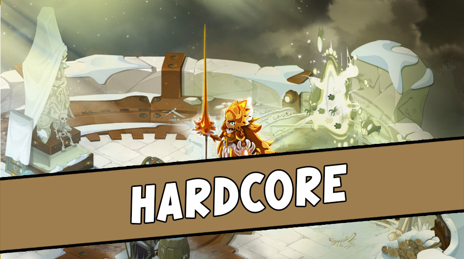
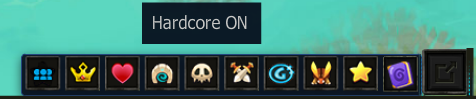
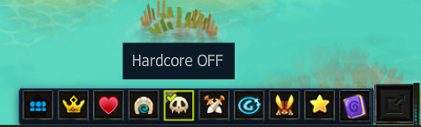

# Modos de Combate

¡Bienvenido, intrépido aventurero! Los modos de juego de **Artemis Dofus 2.51** están diseñados para quienes buscan desafíos intensos y recompensas exclusivas.

Activar uno de estos modos no solo aumentará la dificultad estratégica de tus batallas, sino que también te dará acceso a recursos únicos, monedas especiales y las codiciadas **Reliquias de Mazmorra**.

---

<figure><figcaption>Modo Hardcore — El desafío definitivo de mazmorras en Artemis</figcaption></figure>

## 🛡️ Descubrimiento del Modo Hardcore

🌟 **¡Saludos, aventurero!** 🌟  
¿Intrigado por el modo Hardcore? Estás exactamente en el lugar correcto para aclarar todas tus dudas y comenzar a farmear tus reliquias.

### ❓ ¿Qué es el Modo Hardcore?
Este es un modo que aumenta el nivel de desafío durante las batallas. Al activar este modo, te enfrentarás a monstruos cuyas **estadísticas se multiplican por 4 (x4)**, lo que hará que cada combate sea significativamente más desafiante, táctico y exigente.

### ❓ ¿Por qué activar este modo?
La razón es simple: **¡recompensas tentadoras!** Competir en el modo Hardcore te permite recolectar valiosos recursos exclusivos durante las peleas contra los jefes de las mazmorras. Luego podrás intercambiar estos recursos con el NPC dedicado al final de cada mazmorra para obtener la **Reliquia de Mazmorra** correspondiente.

---

## 🕹️ Cómo Habilitar y Deshabilitar el Modo Hardcore

Para alternar entre activar y desactivar el modo Hardcore, simplemente debes hacer clic en el **icono de la calavera** ubicado en la barra de accesos rápidos de la interfaz inferior de tu pantalla de juego:

<figure><figcaption>Haz clic en el icono de la calavera («Hardcore ON») para activar el modo</figcaption></figure>

---

## 🔎 ¿Cómo asegurarme de que el Modo Hardcore esté habilitado?

Hay dos indicadores en pantalla que lo confirman con total claridad:

1. **Marca de verificación verde en el icono:** El icono de la calavera en la barra inferior mostrará un **borde resaltado y un círculo con marca de verificación verde (✔)** en su esquina superior izquierda.
2. **Indicador de estado en pantalla:** Al colocar el cursor sobre el icono, el texto flotante cambiará a **«Hardcore OFF»** (indicando que el modo está actualmente encendido y que hacer clic lo apagaría). También puedes verificar el indicador de texto de estado en la parte superior izquierda de la pantalla.

<figure><figcaption>El icono con borde verde y el mensaje «Hardcore OFF» confirman que el modo está activo</figcaption></figure>

---

## 🎁 Recompensas y Bonificaciones del Modo Hardcore

* 📈 **Bono de Experiencia:** **+25% XP** en todos los combates.
* 📦 **Recursos Hardcore de Jefes de Mazmorra:**
  * 👤 **Jugador Común (Normal):** **1 recurso** de jefe HC por combate.
  * 🥈 **Jugador Rango VIP:** **2 recursos** de jefe HC por combate *(Doble)*.
  * 👑 **Jugador Rango PREMIUM:** **3 recursos** de jefe HC por combate *(Triple)*.
* 🤖 **Reliquia de Hardcore:** Este modo es el requisito indispensable para fabricar la prestigiosa **Reliquia de Hardcore** con el NPC en el Zaap de Bonta y subirla a su Nivel 1.

---

## ⌛ Modo Temporal

El **Modo Temporal** es el sucesor natural del modo Hardcore, ofreciendo un desafío superior para aventureros que ya dominan las 96 mazmorras base.

* 🎫 **Bono de Experiencia:** **+30% XP**.
* 🎁 **Recursos Obtenidos:**
  * Fichas **Artemis'Temp**.
  * Recursos especiales de mazmorra para la **Mejora Nivel 2 de la Reliquia Hardcore**.
  * Multiplicadores según rango: 1 recurso (Normal) / 2 recursos (VIP) / 3 recursos (PREMIUM).
* ⚡ **Requisito de Acceso:** Poseer todas las reliquias Hardcore y contar con un mínimo de **8.400.000 de estadísticas**.
* 💎 **Multiplicador de Reliquias:** Las reliquias de mazmorra multiplican x5 sus estadísticas generales y x2 sus daños fijos, sabiduría y prospección.

---

## ☠️ Modo Artemis'Hard

El **Modo Artemis'Hard** es el escalón supremo para los jugadores endgame que buscan el máximo poder absoluto con una dificultad extrema.

* 🎫 **Bono de Experiencia:** **+40% XP**.
* 🎁 **Recursos Obtenidos:**
  * Fichas **Artemis'Ton III**.
  * Recursos para la **Mejora Nivel 3 (Máxima) de la Reliquia Hardcore**.
  * Scroll exclusivo de la zona y runas para aumentar el daño a tus equipamientos.
* ⚠️ *Actualmente en desarrollo activo por el equipo de administración.*

---

## 📊 Tabla Comparativa de Modos de Combate

| Modo de Juego | Dificultad de Monstruos | Bono de XP | Recursos de Jefe (Normal / VIP / Premium) | Utilidad Principal |
| :--- | :---: | :---: | :---: | :--- |
| **Normal** | 1x (Base) | Base | Recursos estándar de Dofus | Farmeo inicial y misiones |
| **Hardcore** | **4x Estadísticas** | **+25%** | **1x / 2x / 3x** Recursos HC | Comprar Reliquias de Mazmorra y Reliquia HC Nivel 1 |
| **Temporal** | **Alta Dificultad** | **+30%** | **1x / 2x / 3x** Recursos Temp | Multiplicador x5 en Reliquias y Reliquia HC Nivel 2 |
| **Artemis'Hard** | **Dificultad Extrema** | **+40%** | **1x / 2x / 3x** Artemis'Ton III | Reliquia HC Nivel 3 y Runas de Daño Supremas |
