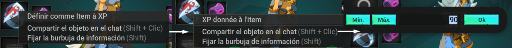
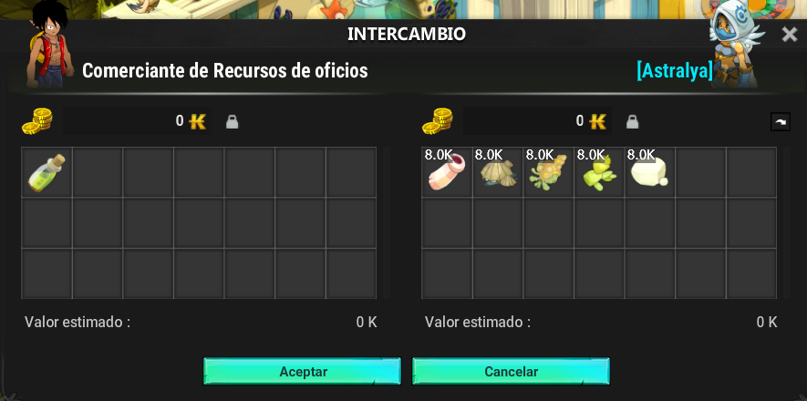

# Prestigio en Items

Esta guía explica cómo maximizar las estadísticas de tus objetos en el juego subiendo experiencia en tus items y realizando prestigios, para realizar un prestigio a un item primero deberás tener el objeto a nivel máximo (100) para esto deberás realizar una asignación de xp el cual explicaremos a continuacion:

### 👣 Pasos Para Asignar XP a un Item

* Acceder al inventario.
* Haga clic derecho en el item que desea levear.
* Seleccione **Establecer como elemento para XP**.
* Seleccione **XP otorgada al artículo**.
* Asigna el 90% de XP al artículo.

<figure><figcaption></figcaption></figure>

<mark style="color:red;">**Nota :**<mark style="color:red;"> <mark style="color:red;"> <mark style="color:red;">La XP obtenida por batalla es limitada, lo que ralentiza el proceso de mejora de objetos. Este proceso se mantiene constante independientemente del nivel del objeto (150 o 200). El objeto podrá ser subido a un máximo de nivel 100, lo cual le otorgará el doble de estadísticas dadas, a excepción de sabiduría, resistencias, pa, pm etc..<mark style="color:red;">

### 🦸 Prestigio en Items&#x20;

* Los prestigios son mejoras específicas mediante pociones de prestigio, disponibles en la tienda por 1500 ogrinas.
* Cada nivel de prestigio duplica las estadísticas base del objeto hasta un máximo de 5 niveles de prestigio, en algunos objetos máximo 2.
* También se pueden crear pociones de prestigio con recursos comerciales del NPC **Comerciante de Recursos Comerciales**.

<figure><figcaption></figcaption></figure>

### 🕹️ Uso Pocima de Prestigio

Su uso es bastante simple, para subir de nivel prestigio un item primero deberás tener este item al nivel 100, de esta manera arrastrando esta pócima hacia el item, podrás hacer uso efectivo de la misma.

Se reiniciará el nivel del item y te aparecerá el prestigio en que se encuentre, para seguir prestigiandolo deberás volver a subir este al nivel 100.

---