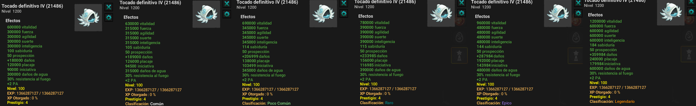

# Rangos en Items

Los rangos en los items se podrán obtener una vez alcanzado el prestigio máximo del objeto

### ⚗️ Mejora de Objetos con Pociones de Rango

Estas pociones de rango de objeto se pueden obtener a través de ogrinas en la tienda de boutique o en el pase de batalla con alguna de las misiones diarias.

Una vez que un objeto alcanza su máximo potencial (Prestigio 5, Nivel 100), puedes usar una Poción de Rango para mejorar aún más sus estadísticas. Hay cinco rangos diferentes:

* **Común:** Aumento de Stats 5%
* **Poco Común:** Aumento de Stats 15%
* **Raro:** Aumento de Stats 30%
* **Épico:** Aumento de Stats 60%
* **Legendario:** Aumento de Stats 100%

<figure><figcaption></figcaption></figure>

### ❌ Pocima de Eliminacion de Rango

Esta pócima podrá eliminar por completo el rango que haya sido otorgado por la anterior pocima, esta deja un malus bastante minimo en el objeto

Esta pócima te ayudará a encontrar el rango preciado por ti, es decir pasar de un común a un legendario.

---