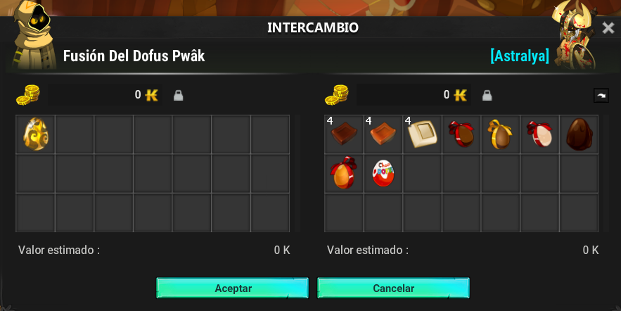

# Zona Pwak

La Zona Pwak es una zona avanzada accesible para aventureros de alto nivel. Ofrece progresión a través de varias mazmorras, un sistema de cupones y la creación de objetos legendarios únicos.

### 🔑 Acceso A La Zona

* Nivel requerido: 200

### ⚔️ Operación General

#### 🏰 Estructura

* La zona consta de **3 mazmorras de dificultad igualitaria.**
* Las mazmorras deben completarse para poder progresar.

### 🎁 Recompensas Principales

* Cada mazmorra te permite **obtener un cupón específico** de su jefe.
* Probabilidad del 10% de Drop **Colgante** en cada mazmorra el cual es requerido para el **Dofus de Mazmorra o Dofus Pwak**.

### 🥚 Dofus y Equipo

#### 🛒 Compras

* En la zona, los NPC TIENDA pueden proporcionarte **Apariencias, Trofeo, Reliquia, Polainas** y **Dofus .**

### 🔮 Fusión Para Dofus Pwak

* Los Dofus de las mazmorras son necesarios para fabricar el **Dofus** **Pwak.**
* Este  Dofus se crea utilizando una **receta especial.**

<figure><figcaption></figcaption></figure>

### ⭐ Puntos clave

* ✅ Progresión lógica con mazmorras para completar sucesivamente
* ✅ Sistema de intercambio y obtención de objetos que fomenta la creación de artículos raros.
* ✅  Dofu&#x73;**'Pwak** como objetivo final

🎯 La Zona Pwak está diseñada para jugadores que buscan un **verdadero desafío de final de juego** , con progresión y recompensas legendarias por ganar.

---