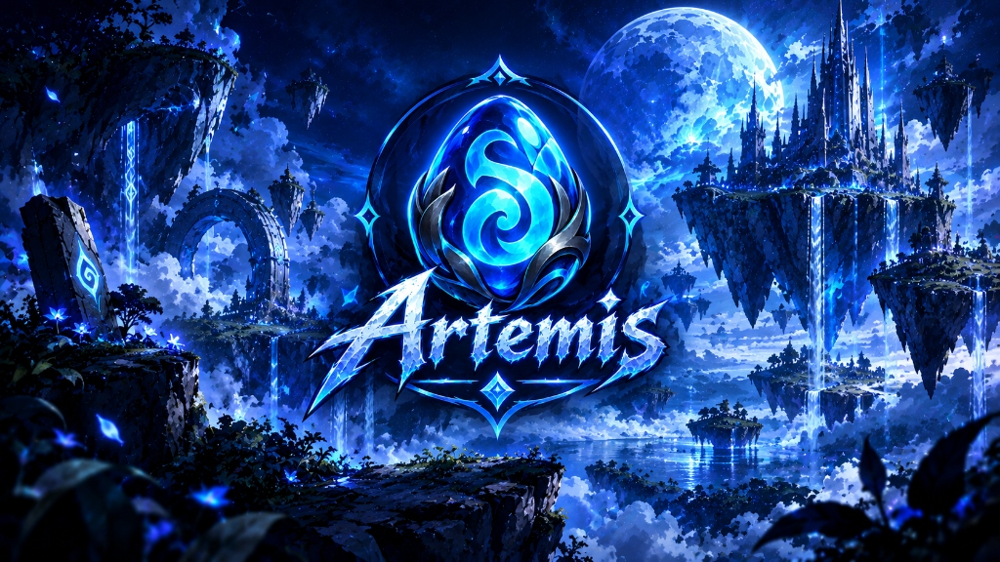

# ⚔️ Bienvenidos a Artemis

  

### 🌌 Servidor Fun Cheto Duo Cuenta — Dofus 2.51

¡Te damos la bienvenida a **Artemis**, el servidor privado definitivo de Dofus 2.51!

Disfruta de una experiencia totalmente renovada, repleta de sistemas exclusivos, progresión acelerada, mazmorras infinitas, reliquias legendarias y una comunidad activa en constante crecimiento.

---

### 🌟 Características Principales del Servidor

* ⚔️ **Modalidad Duo Cuenta:** Juega con tu dúo perfecto de personajes de forma fluida y optimizada.
* 💎 **Sistema de Reliquias Exclusivas:** Evoluciona tu *Artemis'Farm*, Reliquias de Mazmorra, Reliquias de Ogrinas y Reliquias de Rango.
* 💀 **Mazmorras Diarias y Guaridas:** Desafíos diarios con oleadas y multiplicadores de botín.
* 🛠️ **Oficios y Prestigio:** Sube tus profesiones al nivel máximo y prestigéalas para multiplicar tus estadísticas y daño.
* 📜 **Scrolls Personalizados:** Aumenta las características de tu personaje hasta límites colosales.
* 🤖 **Sistemas Automatizados:** Registro y gestión de cuentas en vivo desde nuestro Bot de Discord, soporte por tickets multilingüe y votación automática con recompensas directas.

---

### 🧭 Guía Rápida para Principiantes

1. 🚄 **[Cómo registrarse y descargar el juego](informacion/unete-a-nosotros.md):** Crea tu cuenta en Discord en segundos y descarga el cliente listo para jugar.
2. ⌛ **[Cómo votar y ganar Ogrinas](informacion/vota-y-gana.md):** Apoya al servidor diariamente y recibe +40 Ogrinas automáticas y retos PvM extra.
3. ⭐ **[Progresión y Rangos](juego/progresion-y-rangos.md):** Conoce las bonificaciones diarias y los rangos VIP / Premium.
4. 🎲 **[Guía Artemis'Farm Universal](juego/actividades/artemisfarm-universal.md):** Aprende a forjar la reliquia elemental más poderosa del universo.
